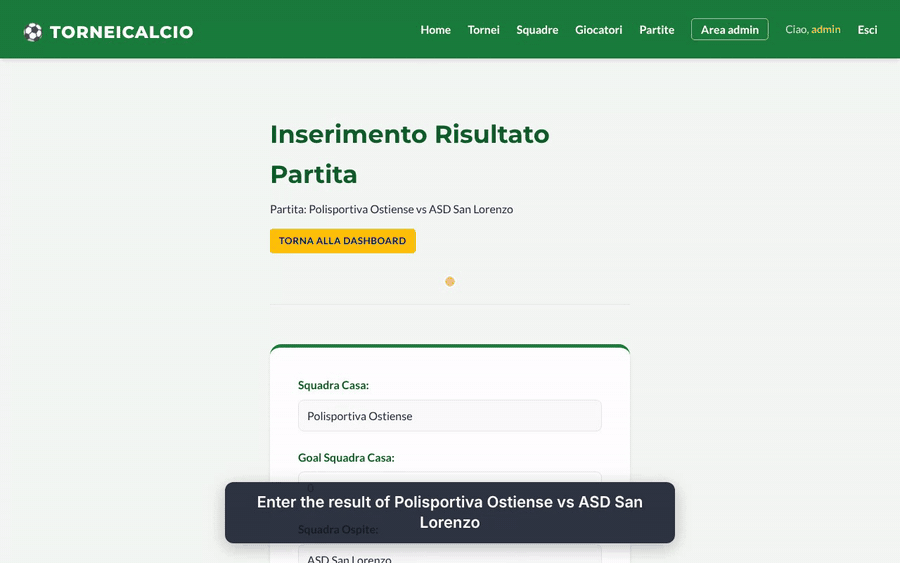
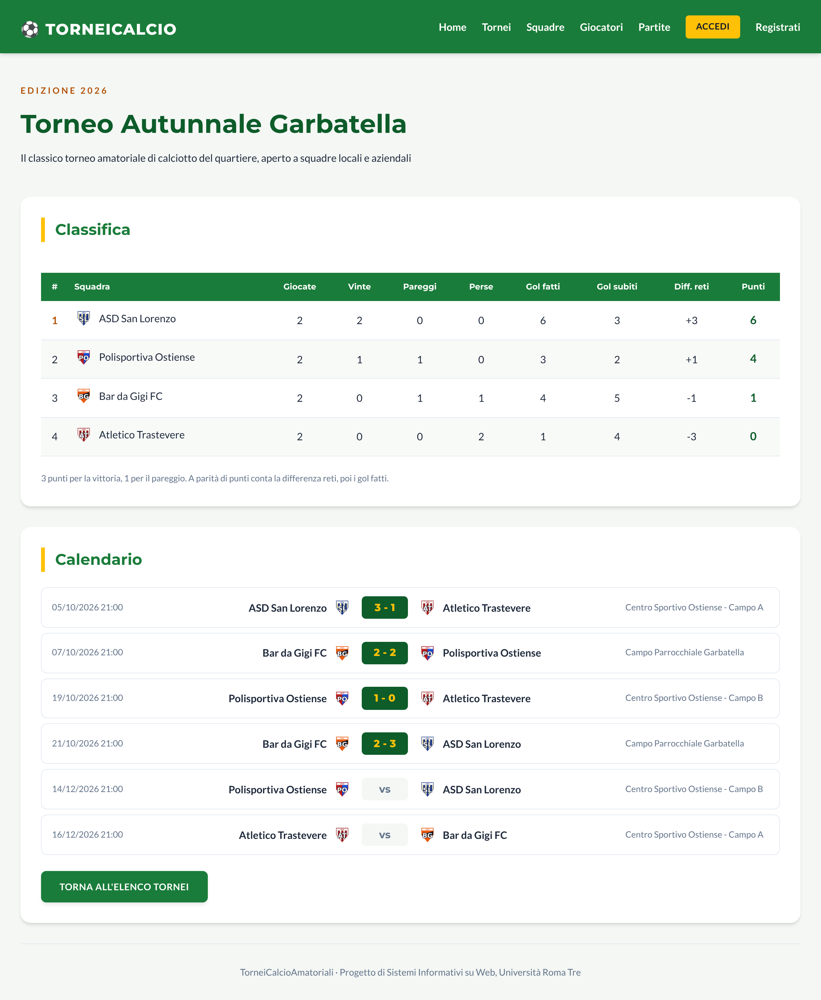
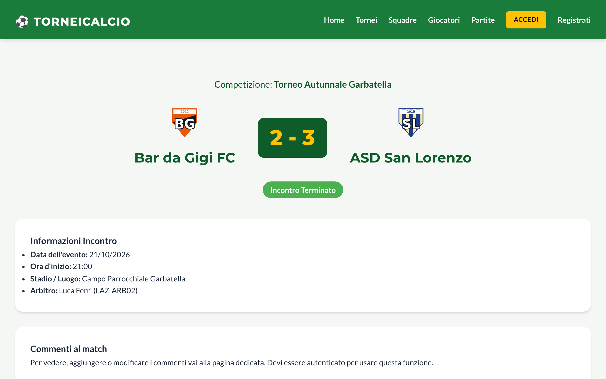
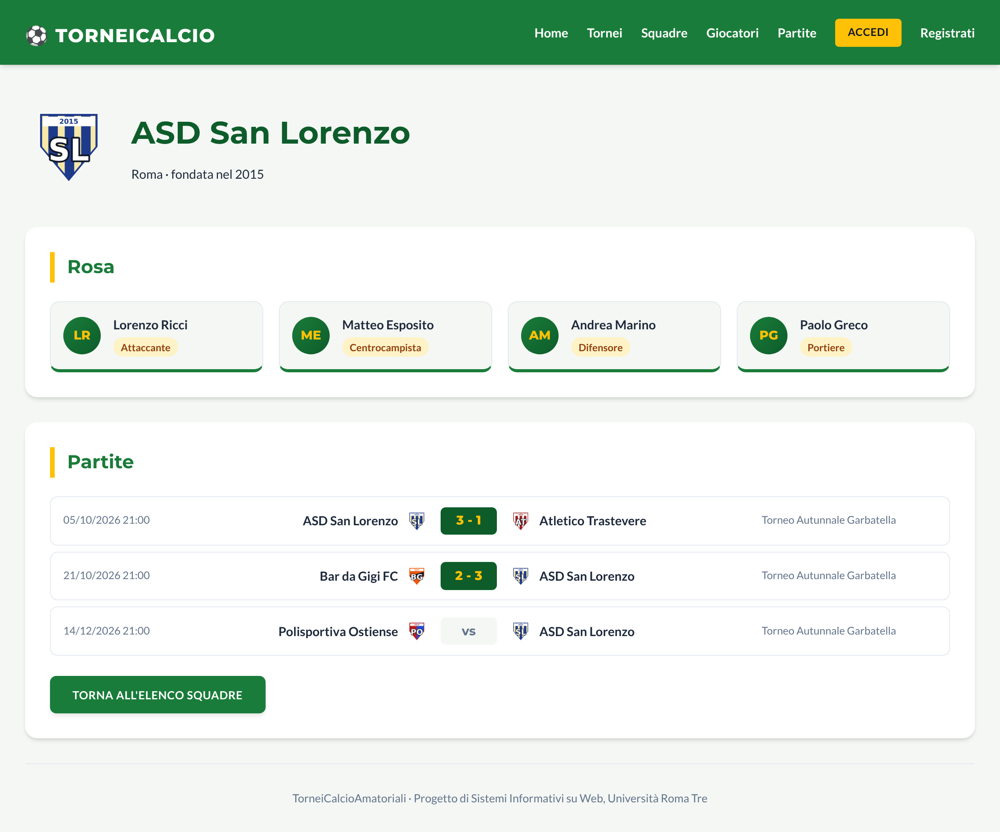
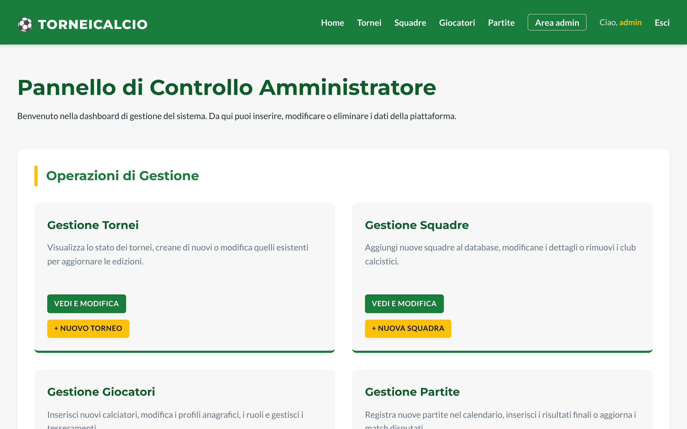

# TorneiCalcioAmatoriali

[](#torneicalcioamatoriali--italiano)

**A web application to run amateur football tournaments: teams, players, match calendar, results and standings that update automatically.** Built with Spring Boot, PostgreSQL and Thymeleaf, plus a React match dashboard that reads a REST endpoint. University project for *Sistemi Informativi su Web* (Roma Tre University).



▶️ **[Full walkthrough video (3 min)](docs/demo-full.mp4)**: guest, registered user (comments), admin (match result → standings), React page and Swagger.

## Features

- **Public pages** for tournaments, teams, players and matches, with no login needed.
- **Standings** for each tournament, computed from the played matches: played, won, drawn, lost, goals for and against, goal difference and points (3 for a win, 1 for a draw). Ties are broken on goal difference, then goals scored.
- **Match calendar** with scheduled and played matches, venue and referee.
- **Team pages** with logo, squad and all the team's matches; **player profiles** with role, age, height and team.
- **Player search** by surname, with pagination.
- **Match comments**: registered users can comment on a match and edit their own comments.
- **Admin panel**: create, edit and delete tournaments, teams (with logo upload), players and matches, and enter match results. Entering, correcting or deleting a result recalculates the points of both teams.
- **Form validation and error pages**: required fields and duplicates are shown next to the field, and missing pages or forbidden actions show a 404 or 403 page.
- **React match dashboard** that loads matches from `GET /rest/partite` and filters them client-side (all, to play, played).

| Tournament standings | Match detail |
|---|---|
|  |  |
| **Team page** | **Admin panel** |
|  |  |

More screenshots in [`docs/screenshots`](docs/screenshots): home, teams, player profile, comments, result form, React dashboard, Swagger UI.

## Tech stack

| Layer | Technologies |
|---|---|
| Backend | Java 17, Spring Boot 3.0 (Web MVC, Data JPA, Security, Validation), Hibernate |
| Database | PostgreSQL |
| Server-side UI | Thymeleaf |
| Frontend (match dashboard) | React 19, TypeScript, Vite, Axios |
| API docs | springdoc-openapi (Swagger UI) |
| Tooling | Maven, Docker Compose, JUnit 5, Mockito |

## Architecture

```
Browser ──► Thymeleaf pages (Spring MVC controllers)    ─┐
                                                         ├─► Services ─► JPA repositories ─► PostgreSQL
React page (Vite) ──► GET /rest/partite (REST controller)┘
```

- **Most of the application is server-side rendered**: Spring MVC controllers return Thymeleaf views for the public pages, comments and the admin panel. All pages share one navbar and footer (Thymeleaf fragments).
- **One REST endpoint** (`GET /rest/partite`, read-only) feeds the React dashboard. It returns DTOs instead of JPA entities, to avoid circular references and expose only the fields the page needs.
- **Layered backend**: `controller` (plus validators for duplicates) → `service` (business rules: standings recalculation, automatic enrollment of the teams of a new match, only the author can edit a comment) → `repository` (Spring Data JPA) → `model` (JPA entities: `Torneo`, `Squadra`, `Giocatore`, `Partita`, `Partecipazione`, `Arbitro`, `Commento`, `Utente`, `Credenziali`).
- **Transactions**: the standings update and the deletion of a match run with `SERIALIZABLE` isolation, so concurrent updates cannot leave inconsistent points.
- **Security**: Spring Security with form login and server-side sessions, BCrypt-hashed passwords, two roles (`ADMIN`, `USER`). Public pages are open, comments need a login, `/admin/**` needs `ADMIN`.
- **Fetch strategies**: a small benchmark compares LAZY, EAGER, JOIN FETCH and Entity Graph loading of a team with its players (profile `benchmark`, see below).

## My role

I developed the project on my own for the course: data model, services, controllers, security, Thymeleaf views and the React page.

After the course (2026) I improved it and prepared it for publication:
- sample database without personal data and a Docker Compose setup;
- unit tests for the main services and a public Swagger UI;
- bug fixes: a crash at startup on an empty database, a crash in the standings when a match had a past date, a server error on a duplicate username, tournaments and teams saved with empty fields;
- a more consistent interface: shared navbar and footer, error pages, team logos, detailed standings, team and player pages;
- this README.

## Quick start (Docker)

Requirements: [Docker Desktop](https://www.docker.com/products/docker-desktop/).

```bash
git clone https://github.com/sarabaranes-dev/TorneiCalcioAmatoriali.git
cd TorneiCalcioAmatoriali
docker compose up --build
```

On the first start PostgreSQL loads the sample data from `db/seed.sql` (2 tournaments, 4 teams with logos, 16 players, 6 matches, 3 comments). When the log shows `Started SiwTorneiCalcioApplication`:

- App: http://localhost:8080
- Swagger UI: http://localhost:8080/swagger-ui/index.html

Stop with `Ctrl+C`, then `docker compose down` (add `-v` to also delete the database and reload the sample data next time).

> Port 5432 must be free: stop any local PostgreSQL first.

Docker runs the backend only. The React dashboard (button **"Apri la dashboard React"** on the matches page) is started separately:

```bash
cd frontend
npm install
npm run dev
```

It runs on http://localhost:5173 (port 5173 must be free, because the backend allows CORS only from this origin).

### Demo accounts

All demo accounts use the password `password`.

| Username | Role | Notes |
|---|---|---|
| `admin` | ADMIN | access to the admin panel |
| `mario` | USER | author of two comments |
| `giulia` | USER | author of one comment |

You can also register a new account (it always gets the `USER` role).

## Run without Docker

Requirements: Java 17, PostgreSQL, Node.js 20+.

1. Create an empty database and load the sample data **before the first start** of the backend:
   ```bash
   createdb tornei_calcio
   psql -d tornei_calcio -f db/seed.sql
   ```
2. Start the backend (default credentials `postgres`/`postgres`; override with `DB_USERNAME` and `DB_PASSWORD`):
   ```bash
   ./mvnw spring-boot:run
   ```
3. Optional, the React dashboard: see the commands above.

To run the fetch-strategy benchmark once at startup (it prints the timings in the log):

```bash
./mvnw spring-boot:run -Dspring-boot.run.profiles=benchmark
```

## Tests

```bash
./mvnw test -Dtest='*ServiceTest'
```

12 unit tests (JUnit 5 + Mockito, no database needed) cover the main business rules:
- entering or correcting a result recalculates both teams' points without counting a match twice;
- played matches without a score are ignored;
- deleting a played match removes its points;
- a new match is scheduled or played depending on its date and enrolls both teams in the tournament;
- the detailed standings count wins, draws, losses and goals, and break ties on goal difference;
- only the author can edit a comment;
- a new account always gets the `USER` role and a hashed password.

`./mvnw test` also runs a Spring context test, which needs PostgreSQL running.

## Known limitations

- The React frontend covers only the match dashboard; the rest of the UI is Thymeleaf. The REST API is a single read-only endpoint, and the backend and dashboard URLs (`localhost:8080`, `localhost:5173`) are hard-coded.
- A match created with a past date is saved as played without a score, and it counts in the standings only after the admin enters its result.
- Team logos are stored in the database as binary data. The logos in the sample data are fictional crests made for this demo.
- The schema is managed by Hibernate (`ddl-auto=update`), without migrations.
- Tests cover the service layer only; there are no controller or end-to-end tests.
- The UI is in Italian.

---

# TorneiCalcioAmatoriali — Italiano

**Un'applicazione web per gestire tornei di calcio amatoriali: squadre, giocatori, calendario, risultati e classifica che si aggiorna da sola.** Realizzata con Spring Boot, PostgreSQL e Thymeleaf, più una dashboard delle partite in React che legge un endpoint REST. Progetto universitario per *Sistemi Informativi su Web* (Università Roma Tre).

▶️ **[Video completo (3 min)](docs/demo-full.mp4)**: ospite, utente registrato (commenti), admin (risultato → classifica), pagina React e Swagger.

## Funzionalità

- **Pagine pubbliche** di tornei, squadre, giocatori e partite, senza login.
- **Classifica** di ogni torneo calcolata dalle partite giocate: giocate, vinte, pareggi, perse, gol fatti e subiti, differenza reti e punti (3 per la vittoria, 1 per il pareggio). A parità di punti contano la differenza reti e poi i gol fatti.
- **Calendario** con partite in programma e giocate, luogo e arbitro.
- **Pagine squadra** con logo, rosa e partite; **schede giocatore** con ruolo, età, altezza e squadra.
- **Ricerca giocatori** per cognome, con paginazione.
- **Commenti alle partite**: gli utenti registrati commentano e modificano i propri commenti.
- **Pannello admin**: creazione, modifica ed eliminazione di tornei, squadre (con logo), giocatori e partite, e inserimento dei risultati. Inserire, correggere o eliminare un risultato ricalcola i punti di entrambe le squadre.
- **Validazione e pagine di errore**: campi obbligatori e duplicati sono segnalati accanto al campo; pagine inesistenti o azioni non permesse mostrano una pagina 404 o 403.
- **Dashboard React** che carica le partite da `GET /rest/partite` e le filtra lato client.

## Architettura

- **La maggior parte dell'applicazione è renderizzata lato server**: i controller Spring MVC restituiscono viste Thymeleaf, con navbar e footer comuni a tutte le pagine.
- **Un solo endpoint REST** (`GET /rest/partite`, in sola lettura, con DTO) alimenta la dashboard React.
- **Backend a livelli**: `controller` (con validator per i duplicati) → `service` (ricalcolo della classifica, iscrizione automatica delle squadre, solo l'autore modifica un commento) → `repository` (Spring Data JPA) → `model` (entità JPA).
- **Transazioni**: aggiornamento della classifica ed eliminazione di una partita con isolamento `SERIALIZABLE`.
- **Sicurezza**: Spring Security con form login e sessione, password cifrate con BCrypt, due ruoli (`ADMIN`, `USER`).
- **Strategie di fetch**: un piccolo benchmark confronta LAZY, EAGER, JOIN FETCH ed Entity Graph (profilo `benchmark`).

## Il mio ruolo

Ho sviluppato il progetto da sola per il corso: modello dei dati, service, controller, sicurezza, viste Thymeleaf e pagina React.

Dopo il corso (2026) l'ho migliorato e preparato per la pubblicazione:
- database di esempio senza dati personali e Docker Compose;
- test unitari sui service principali e Swagger pubblico;
- correzione di bug: crash all'avvio su database vuoto, crash della classifica con partite in data passata, errore del server con username già usato, tornei e squadre salvati con campi vuoti;
- interfaccia più coerente: navbar e footer comuni, pagine di errore, loghi delle squadre, classifica dettagliata, pagine squadra e giocatore;
- questo README.

## Avvio rapido (Docker)

```bash
git clone https://github.com/sarabaranes-dev/TorneiCalcioAmatoriali.git
cd TorneiCalcioAmatoriali
docker compose up --build
```

Al primo avvio PostgreSQL carica i dati di esempio da `db/seed.sql`. App su http://localhost:8080, Swagger su http://localhost:8080/swagger-ui/index.html. Account demo: `admin`, `mario`, `giulia`, tutti con password `password`. La porta 5432 deve essere libera. La dashboard React si avvia a parte (`cd frontend && npm install && npm run dev`, porta 5173).

Per l'avvio senza Docker, il benchmark e i test valgono i comandi della sezione inglese (12 test unitari sui service).

## Limiti noti

- React copre solo la dashboard delle partite; il resto dell'interfaccia è in Thymeleaf. L'API REST è un solo endpoint in sola lettura, e gli indirizzi `localhost:8080` e `localhost:5173` sono scritti nel codice.
- Una partita creata con una data passata viene salvata come giocata senza risultato, e conta in classifica solo dopo che l'admin inserisce il risultato.
- I loghi delle squadre sono salvati nel database come dati binari. I loghi dei dati di esempio sono stemmi inventati per questa demo.
- Lo schema è gestito da Hibernate (`ddl-auto=update`), senza migrazioni.
- I test coprono solo il livello service; non ci sono test sui controller né end-to-end.
- L'interfaccia è in italiano.
